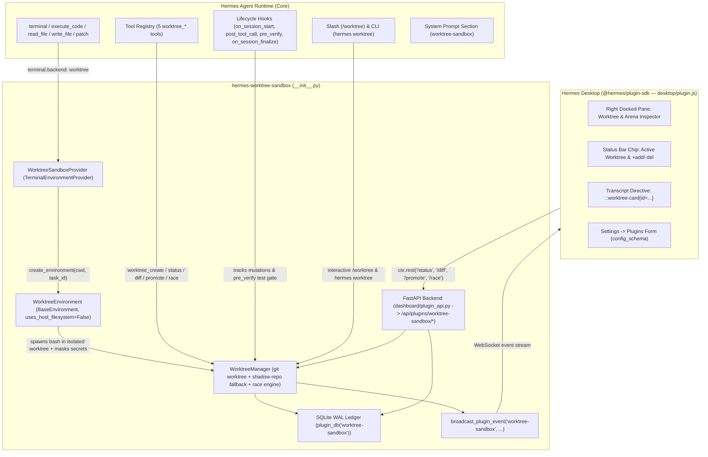

# PLAN.md — `hermes-worktree-sandbox`

> **Plugin Name:** `worktree-sandbox` (Repo: `hermes-worktree-sandbox`)  
> **Author / Maintainer:** `mahammadbakr`  
> **Target Deadline:** November 11, 2026 @ 5:00 PM EST (Code & Demo Freeze: November 10, 2026)

---

## 1. Problem Statement, Goals & Explicit Non-Goals

### Problem Statement
When developers run Hermes Agent on a local repository (`terminal.backend: local`), every file edit (`write_file`, `patch`), shell command (`terminal`), and code execution (`execute_code`) mutates the live working tree in place. If the agent makes a destructive edit, leaves half-finished refactoring changes, or spawns parallel subagents via `delegate_task`, the working directory becomes polluted or corrupted. Existing container/sandbox plugins (`bubblewrap`, `singularity`) are Linux-only or require heavy cloud VMs (`cua-spaces`, `smolmachines`), and none provide transactional Git-worktree isolation or parallel branch racing with one-click visual promotion in Hermes Desktop.

### Goals
1. **Transactional Git-Worktree Terminal Environment (`terminal.backend: worktree`):** Implement `agent.terminal_env_provider.TerminalEnvironmentProvider` and `tools.environments.BaseEnvironment` (`uses_host_filesystem = False`, `is_remote = False`, `is_container = False`, `session_isolated_when_nonpersistent = True`) so every command (`terminal`, `execute_code`) and file tool (`read_file`, `write_file`, `patch`, `search_files`) executes inside an isolated Git worktree (`$HERMES_HOME/plugin-data/worktree-sandbox/worktrees/<session_or_task_id>`) while the user's primary checkout remains 100% untouched until explicitly promoted.
2. **Multi-Approach Speculative Arena (`worktree_race` & Tools):** Provide 5 deterministic agent tools (`worktree_create`, `worktree_status`, `worktree_diff`, `worktree_promote`, `worktree_race`) that let the agent—or the user—spin up isolated candidate worktrees, run a verification/benchmark command across competing candidate branches in parallel (with both live `ctx.subagent_lifecycle` support and a deterministic offline/command evaluator mode), score them on exit code, test pass count, diff size, and latency, and promote the winner.
3. **Automatic Lifecycle & Verification Hooks:** Use `post_tool_call` and `pre_verify` hooks plus `on_session_start` / `on_session_finalize` to record every worktree transaction into a WAL-mode SQLite ledger (`plugin_db("worktree-sandbox")`) and broadcast real-time updates (`broadcast_plugin_event("worktree-sandbox", "updated", ...)`) to connected Hermes Desktop and TUI clients.
4. **In-Session Slash Command (`/worktree`) & CLI (`hermes worktree`):** Support `/worktree status|diff|create|promote|discard|race|demo` across CLI, TUI, Desktop, and Messaging Gateways (using `ctx.ask_choice` when interactive) plus `hermes worktree status|list|prune|demo` on the command line.
5. **Native Hermes Desktop UI (`desktop/plugin.js` + `dashboard/plugin_api.py`):**
   - Right-hand docked **Worktree Sandbox & Arena** pane (`PANES_AREA`) showing active worktrees, live `+added / -deleted` line counts, unified diffs, one-click **Promote (Merge/Apply)** and **Discard** buttons, and a **Run Demo Race** trigger.
   - Status bar chip (`STATUSBAR_AREAS.right`) showing active worktree isolation status and net diff stats.
   - Inline transcript directive (`TRANSCRIPT_DIRECTIVE_AREA`, `::worktree-card{...}`) rendering interactive side-by-side Arena comparison cards inside assistant messages.

### Explicit Non-Goals
- Replacing Docker/VM kernel-level OS virtualization (we isolate the Git working tree, `$TMPDIR`, and environment variables on macOS/Linux without requiring root, Linux user namespaces, or Docker).
- Supporting non-Git directories without a fallback (when run outside a Git repo, `WorktreeEnvironment` automatically initializes a shadow Git snapshot in `$HERMES_HOME/plugin-data/worktree-sandbox/shadow-repos/` so every directory works out of the box).
- Making any external network calls, requiring any API keys, or shipping any compiled binaries.

---

## 2. Architecture Diagram & Component Breakdown



### Component Breakdown

| File | Responsibility |
|---|---|
| `plugin.yaml` | Manifest v2 declaring `name: worktree-sandbox`, `version: 0.1.0`, `requires_hermes: ">=0.22.5"`, `provides_tools`, `provides_hooks`, `config_schema`. |
| `__init__.py` | `register(ctx)` entry point wiring `WorktreeSandboxProvider`, 5 tools, 4 hooks, `/worktree` slash command, `hermes worktree` CLI command, and system prompt section. |
| `provider.py` | `WorktreeSandboxProvider(TerminalEnvironmentProvider)` + `WorktreeEnvironment(BaseEnvironment)` implementing `_run_bash`, `cleanup`, `is_available`, `probe`, `doctor_checks`, `setup_instructions`, `strip_env_keys`. |
| `manager.py` | Core `WorktreeManager`: creates/reuses Git worktrees (with automatic shadow-repo fallback for non-Git folders), computes file diffs/stats, applies/promotes diffs back to the source workspace (with dirty-target conflict guards and backup snapshots), discards/prunes worktrees, and runs the multi-candidate `race` arena. |
| `storage.py` | Thread-safe WAL-mode SQLite ledger (`plugin_db("worktree-sandbox")`) storing worktree sessions, tool mutation events, and race benchmark results. |
| `schemas.py` | OpenAI JSON schemas for `worktree_create`, `worktree_status`, `worktree_diff`, `worktree_promote`, and `worktree_race`. |
| `tools.py` | JSON-returning tool handlers (`def handler(args: dict, **kwargs) -> str`, never raising) that invoke `WorktreeManager`, record state, and emit Desktop events. |
| `cli.py` | `/worktree` slash command handler (with `ctx.ask_choice` support) and `hermes worktree` CLI subcommands (`status`, `list`, `diff`, `promote`, `discard`, `race`, `demo`, `prune`). |
| `dashboard/manifest.json` | Declares backend router `plugin_api.py` for `/api/plugins/worktree-sandbox/`. |
| `dashboard/plugin_api.py` | FastAPI `APIRouter` exposing `GET /status`, `GET /worktrees`, `GET /diff/{worktree_id}`, `POST /create`, `POST /promote`, `POST /discard`, and `POST /race` (including a self-contained `/demo-race` seed workflow). |
| `desktop/plugin.js` | Uncompiled ESM plugin using `@hermes/plugin-sdk`, `react`, and `react/jsx-runtime` (`PANES_AREA`, `STATUSBAR_AREAS.right`, `PALETTE_AREA`, `TRANSCRIPT_DIRECTIVE_AREA`). |

---

## 3. Plugin Manifest & Catalog Entry Drafts

### `plugin.yaml`
```yaml
name: worktree-sandbox
label: Worktree Sandbox
version: "0.1.0"
manifest_version: 2
api_version: 1
kind: standalone
author: mahammadbakr
license: MIT
homepage: https://github.com/mahammadbakr/hermes-worktree-sandbox
description: >-
  Transactional Git-worktree terminal backend and speculative execution arena:
  runs commands and file edits in isolated Git worktrees with secret masking,
  parallel candidate racing, and one-click diff promotion in Hermes Desktop.
requires_hermes: ">=0.22.5"
platforms:
  - linux
  - macos
tags:
  - terminal
  - sandbox
  - worktree
  - git
  - desktop
provides_tools:
  - worktree_create
  - worktree_status
  - worktree_diff
  - worktree_promote
  - worktree_race
provides_hooks:
  - on_session_start
  - post_tool_call
  - pre_verify
  - on_session_finalize
provides_middleware: []
requires_env: []
capabilities: []
python_dependencies: []
config_schema:
  auto_isolate:
    type: bool
    default: true
    label: Auto-isolate sessions
    description: Automatically create an isolated Git worktree for each task when terminal.backend is worktree.
  keep_on_exit:
    type: bool
    default: true
    label: Keep worktrees after session ends
    description: Retain worktrees with uncommitted or unpromoted changes after session teardown for review in Desktop.
  verify_command:
    type: str
    default: ""
    label: Default verification command
    description: Optional shell command (e.g. pytest -q) run during worktree_race or pre_verify checks.
  max_worktrees:
    type: int
    default: 20
    label: Maximum retained worktrees
    description: Maximum number of managed worktrees before oldest clean worktrees are pruned.
```

---

## 4. Data Flow & Graceful Failure Modes

| Scenario / Failure Mode | Detection | Graceful Handling & Fallback |
|---|---|---|
| **Workspace is not a Git repository** | `git rev-parse --show-toplevel` exits non-zero | Automatically initializes a lightweight shadow Git repository in `$HERMES_HOME/plugin-data/worktree-sandbox/shadow-repos/<hash>/` mirroring workspace text files (<10 MB, skipping `.venv`, `node_modules`, secrets) so worktree isolation still works seamlessly. |
| **`git` binary missing from `PATH`** | `shutil.which("git") is None` | `is_available()` returns `False`, `probe()` returns `("unavailable", "git not found on PATH")`, and tools return a clean JSON error `{"ok": false, "error": "git is required on PATH"}` without crashing Hermes. |
| **Target file modified on host since worktree branched** | SHA-256 baseline check before `worktree_promote` | `worktree_promote` refuses to clobber conflicting host edits unless `force=True` is passed, returning the exact conflicting file paths and saving a `.bak` snapshot in `$HERMES_HOME/plugin-data/worktree-sandbox/backups/`. |
| **Subprocess / test command hangs during `worktree_race`** | `subprocess.run(..., timeout=timeout_s)` raises `TimeoutExpired` | Process group is killed cleanly (`os.killpg`), candidate is scored as `status: "timed_out"` with partial output preserved, and other race candidates continue unaffected. |
| **Unattended / Cron / Gateway session calls `/worktree promote` without args** | `ctx.ask_choice()` returns `None` | Never hangs; falls back to returning a clear text usage hint listing available worktree IDs. |
| **Desktop window open while backend plugin is disabled** | `ctx.rest('/status')` returns 404 or error | `desktop/plugin.js` catches the rejection and renders a friendly `EmptyState` explaining how to enable `worktree-sandbox` in `config.yaml`. |

---

## 5. Security & Permissions Review

1. **Public Surfaces Only (Catalog Rule 9):** Imports only documented Public Plugin API modules (`agent.terminal_env_provider`, `tools.environments.base`, `agent.runtime_cwd`, `hermes_cli.config`, `hermes_cli.plugin_events`, `hermes_constants`, `plugins.plugin_storage`, `plugins.plugin_utils`). Zero monkey-patching, zero private `_` method calls on core objects.
2. **Secret Stripping & File Exclusions (Catalog Rule 11):**
   - Never reads `.env`, `~/.hermes/auth.json`, `~/.codex/auth.json`, `~/.ssh`, or any credential store.
   - `WorktreeEnvironment` strips sensitive Hermes/provider environment variables (`OPENAI_API_KEY`, `ANTHROPIC_API_KEY`, `OPENROUTER_API_KEY`, `GITHUB_TOKEN`, `GH_TOKEN`, `SSH_AUTH_SOCK`, etc.) and isolates `TMPDIR` per worktree.
   - Shadow-repo and diff snapshots explicitly skip `.env*`, `*secret*`, `*token*`, `*.pem`, `*.key`, `.git`, `.hermes`, `node_modules`, and `.venv`.
3. **Path Traversal Confinement:** All worktree IDs are validated against `^[a-zA-Z0-9_-]{1,64}$`. Any resolved path is checked via `Path.resolve().is_relative_to(...)` before read, write, diff, or removal.
4. **Approvals Respected (Catalog Rule 12):** `WorktreeSandboxProvider` sets `is_container = False` (`skip_container_guards = False`) so Hermes's dangerous-command approval prompts remain active on host commands.

---

## 6. Test Strategy

1. **Unit Tests (`tests/test_worktree_sandbox.py`):**
   - `WorktreeManager`: creating worktrees in a real temp Git repo, shadow-repo fallback in a non-Git dir, file modification tracking, unified diff generation, conflict-safe promotion (`promote`), backup creation, rollback, and pruning.
   - `WorktreeEnvironment` & `WorktreeSandboxProvider`: `_run_bash` execution, CWD persistence across commands, stdin piping, timeout handling, secret env stripping, `is_available()`, `probe()`, `doctor_checks()`.
   - `worktree_race`: parallel candidate execution, verification command scoring, winner selection, timeout resilience, and demo seed mode.
   - Tool handlers & CLI/Slash commands: verifying every handler returns valid JSON strings and never raises on bad inputs.
2. **Hermes Integration & Admission Validation Tests (`tests/test_hermes_integration.py`):**
   - Loads the plugin through Hermes's real `hermes_cli.plugin_validate.validate_plugin_dir()` and asserts `report.ok is True` and `report.warnings == []`.
   - Runs `scripts/scan_plugin_payloads.py` and `scripts/validate_plugin_catalog.py` against our catalog entry draft.
   - Tests `desktop/plugin.js` against `hermes_cli.plugin_validate_desktop.check_desktop_surface` (asserting 0 forbidden hits and 0 review warnings).

---

## 7. Day-by-Day Schedule, Milestones & Cut Line (Nov 6 – Nov 11)

| Milestone | Target Date | Scope | Definition of Done |
|---|---|---|---|
| **M0: Plan & Repo Scaffold** | Nov 6 (Today) | `PLAN.md`, `README.md`, `LICENSE`, `CHANGELOG.md`, `TODO.md`, `DEMO.md`, `plugin.yaml`, CI workflow, git init. | Clean initial commit on `main`. |
| **M1: Vertical Slice (Core Provider & Worktree Engine)** | Nov 6 (Today) | `storage.py`, `manager.py`, `provider.py`, `schemas.py`, `tools.py`, `__init__.py` loading in real Hermes validator and executing commands in an isolated Git worktree. | `validate_plugin_dir` passes; vertical slice test creates a worktree, runs a command inside it, leaves host untouched, and promotes diff. |
| **M2: Speculative Race Arena, Hooks & Slash/CLI** | Nov 7 | `worktree_race` parallel evaluator, `pre_verify`/`post_tool_call` hooks, `/worktree` slash command + `hermes worktree` CLI, non-Git shadow repo fallback, demo seed generator. | All 5 tools, 4 hooks, slash command, and CLI subcommands tested with >90% branch coverage. |
| **M3: Unified Desktop UI & FastAPI Backend** | Nov 8 | `dashboard/manifest.json`, `dashboard/plugin_api.py`, `desktop/plugin.js` (Right Pane, Statusbar Chip, Palette Commands, `::worktree-card` Transcript Directive). | Desktop lint (`check_desktop_surface`) passes with 0 warnings; FastAPI endpoints tested end-to-end. |
| **M4: End-to-End Polish, Catalog YAML & Full Validation** | Nov 9 | Complete `README.md`, `DEMO.md`, `catalog-entry/worktree-sandbox.yaml`, full `hermes plugins validate` + `validate_plugin_catalog.py` + `scan_plugin_payloads.py` verification. | All 14 Hermes admission checks pass with 0 errors and 0 warnings. |
| **M5: Buffer, PR Submission & 90s Video Recording** | Nov 10–11 | Push public GitHub repo, pin 40-char SHA in `plugin-catalog/worktree-sandbox.yaml`, open PR to `NousResearch/hermes-agent`, record 60–90s X video tagging `@NousResearch`. | PR green & submitted via hackathon form before Nov 11 5PM EST. |

### Cut Line
- **Must-Have (P0):** `WorktreeSandboxProvider` (`terminal.backend: worktree`), `WorktreeEnvironment`, 5 `worktree_*` tools (including `worktree_race` & `worktree_promote`), 4 lifecycle hooks, `/worktree` slash command, `hermes worktree` CLI, `dashboard/plugin_api.py`, `desktop/plugin.js` (Pane + Statusbar + `::worktree-card` directive), and 100% passing `hermes plugins validate`.
- **Nice-to-Have (P1):** Automatic shadow-Git fallback for non-Git directories; automatic `.bak` safety backups before `promote` overwrites host files; built-in `/worktree demo` one-command demo seed for instant video recording. *(Included in M1–M2!)*
- **Stretch (P2):** Custom patch hunk-by-hunk cherry-picking UI inside the Desktop pane (cut if behind schedule; file-level filter in `worktree_promote` is sufficient).

---

## 8. Risk Register

| Risk | Likelihood | Impact | Mitigation / Fallback |
|---|---|---|---|
| Private import warning in `hermes plugins validate` | Medium | High | Strictly import only from modules listed in `hermes_cli/data/plugin_api.json`; test every commit against `hermes_cli.plugin_validate.validate_plugin_dir`. |
| Desktop surface lint flags a selector or import in `desktop/plugin.js` | Low | High | Only import `@hermes/plugin-sdk`, `react`, `react/jsx-runtime`; use `jsx()`/`jsxs()` calls (no JSX); test with `check_desktop_surface()`. |
| Live LLM latency during 90-second demo video recording | Medium | Medium | Ship `/worktree demo` and `POST /api/plugins/worktree-sandbox/demo-race` which seed a real 2-branch Git worktree race (Regex vs State-Machine parser optimization) and run real `pytest`/`python3` benchmarks in <1.5 seconds with zero network dependency. |
| Dirty host working tree causes merge conflict on promote | Medium | Medium | Compare baseline SHA-256 hashes of touched files before promoting; save backup copies under `plugin-data/worktree-sandbox/backups/` and refuse overwrite unless `force=True`. |

---

## 9. Decisions Log

- **2026-11-06 (D1):** Selected **Idea 1 (`hermes-worktree-sandbox`)** (`plugin.yaml` name: `worktree-sandbox`) as our hackathon entry.
- **2026-11-06 (D2):** Cloned `NousResearch/hermes-agent` (sparse checkout of Python core + validators) into `/private/var/folders/0v/8s97r54s5l73z3_5tx2khllw0000gn/T/opencode/hermes-agent` with Python 3.14.2 venv so we can run the real `hermes_cli.plugin_validate`, `scripts/validate_plugin_catalog.py`, and `scripts/scan_plugin_payloads.py` on every milestone.
- **2026-11-06 (D3):** Set maintainer/author to `mahammadbakr` (verified via `gh api user`).
- **2026-11-06 (D4):** Implemented `WorktreeEnvironment` by subclassing `tools.environments.base.BaseEnvironment` directly (`uses_host_filesystem = False`) rather than `LocalEnvironment` to avoid any private core imports while guaranteeing all Hermes file tools route through the isolated worktree.
