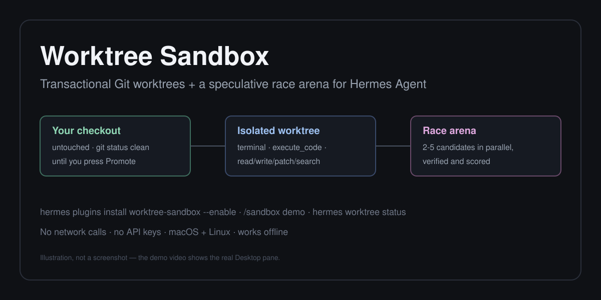
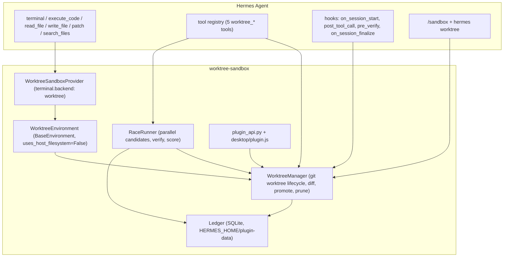

# Worktree Sandbox (`worktree-sandbox`)

**Transactional Git worktrees and a speculative race arena for [Hermes Agent](https://github.com/NousResearch/hermes-agent).**

`worktree-sandbox` makes the agent's edits reversible and its choices evidence-based. It registers a
real `terminal.backend` (`worktree`) so every `terminal`, `execute_code` and file-tool call runs
inside its own isolated Git worktree — your checkout stays byte-for-byte untouched until you promote.
Its `worktree_race` tool then runs two to five competing solutions **in parallel isolated worktrees**,
verifies each with your project's own test command, scores them on pass/fail → speed → diff size, and
surfaces the leaderboard in a docked Hermes Desktop pane, a live status-bar chip, and an inline
`::worktree-card` in the transcript — with one-click promote and a timestamped backup.



*Illustration, not a screenshot — the [demo video](#demo-video) shows the real Desktop pane.*

---

## Why this is more than a prompt or a skill

A skill can *ask* the model to be careful. This plugin changes what Hermes actually does:

| Capability | How | Why a prompt/skill cannot do it |
|---|---|---|
| Every command and file edit lands in an isolated worktree | `TerminalEnvironmentProvider` + a `BaseEnvironment` with `uses_host_filesystem = False` | Only a registered environment backend can route `read_file`/`write_file`/`patch`/`search_files` and `terminal`/`execute_code` through a different filesystem root at the runtime layer. |
| Credentials are stripped from the shell the agent's commands run in | `WorktreeEnvironment._runtime_env()` scrubs `*_API_KEY`/`*_TOKEN`/`*_SECRET` and Hermes's per-turn session vars, and sets a private `TMPDIR` | A skill cannot control a spawned subprocess's environment. |
| Competing solutions are executed, verified and scored in parallel | `worktree_race` creates N worktrees, runs each candidate's verification command with a hard timeout and process-group kill, and scores the results deterministically | A skill can only describe a process; this measures it. |
| Failures keep the agent working instead of declaring success | `pre_verify` hook runs the configured verification command inside the worktree and returns a `continue` directive on failure | Hooks with a documented steering return are a plugin-only surface. |
| Live Desktop UI | `plugin/desktop/plugin.js` (SDK pane, status chip, palette commands, transcript directive) + `plugin/dashboard/plugin_api.py` | The Desktop plugin SDK is not reachable from a prompt. |

---

## Install

From the Nous plugin catalog (recommended — pinned, reviewed commit):

```bash
hermes plugins install worktree-sandbox --enable
```

Directly from this repository (the plugin lives in the `plugin/` subdirectory):

```bash
hermes plugins install mahammadbakr/hermes-worktree-sandbox#plugin --enable
```

Make `worktree` your default transactional terminal backend:

```bash
hermes config set terminal.backend worktree
```

You do **not** have to change the backend: even with `terminal.backend: local`, the five
`worktree_*` tools, the `/sandbox` command, the `hermes worktree` CLI and the Desktop pane are
available for explicit isolation and racing.

Requirements: **macOS or Linux**, `git` and `bash` on `PATH`, Hermes Agent ≥ 0.22.5. No API keys, no
network access, no extra Python dependencies.

---

## Quickstart (under 2 minutes)

### 1. See it work — one command, offline

```text
/sandbox demo
```

or from a terminal:

```bash
hermes worktree demo
```

This seeds a self-contained project and races two parsers in parallel worktrees, then prints:

```text
Demo race complete in 804 ms (verify: python -m unittest -q test_parser)

  1. careful        PASS         97 ms  +1/-2 in 1 file(s)  score 1188.15
  2. quick-split    FAIL        107 ms  +4/-6 in 1 file(s)  score 186.8

  winner: careful
```

No network, no model call, no API key — repeatable for demos.

### 2. Isolate a real task

Ask Hermes to change your project, then:

```text
/sandbox status                 # worktrees with +added/-deleted stats
/sandbox diff <worktree_id>     # exactly what promoting would change
/sandbox promote <worktree_id>  # apply it (conflict-checked, backup written first)
/sandbox discard <worktree_id>  # throw the worktree away
```

In the Hermes Desktop app the same actions live in the **worktrees** pane on the right, with a
status-bar chip showing live `+added/-deleted`.

---

## Example prompts / workflows

**Racing two implementations (the strongest use):**

> "Our JSON config loader is slow. Race a caching version against a streaming version: use the
> project's pytest suite to verify and show me the leaderboard. Don't apply anything yet."

The agent calls `worktree_race` with two candidates and `verify_command: "pytest -q"`. You get a
scored leaderboard and can promote the winner with one click.

**Keeping a risky refactor reversible:**

> "Refactor `parsers/` to use the new registry API — leave my working tree alone, I'll review the
> diff first."

The agent edits inside the worktree; `/sandbox diff` shows the change; `/sandbox promote` applies it.

**Reviewing an agent's work before it lands (cron/background):**

> Set `verify_command: "make test"` in the plugin settings. When the agent finishes a code change,
> `pre_verify` runs `make test` in the worktree and pushes the agent back to work on failure instead
> of reporting success.

---

## Tools

| Tool | What it does |
|---|---|
| `worktree_create` | Create or reuse an isolated Git worktree for a task (a non-Git folder is mirrored into a private shadow repo automatically). |
| `worktree_status` | Managed worktrees with per-file status and `+added/-deleted` line stats. |
| `worktree_diff` | Unified diff of a worktree against its base commit (truncated past 200 KB). |
| `worktree_promote` | Conflict-checked, backed-up application of a worktree's changes into the real checkout. Refuses files the user edited since the base; `files` narrows it to a subset. |
| `worktree_race` | Run 2–5 candidates in parallel worktrees, verify each, score them, optionally promote the winner. |

`worktree_status`, `worktree_diff` and `worktree_promote` all report a `note`, `filtered`, `unmatched`
or `skipped` list when something was deliberately left out, so nothing is dropped silently.

---

## Commands

| Command | Where |
|---|---|
| `/sandbox [status\|list\|diff <id>\|promote <id> [--force]\|discard <id>\|prune [n]\|demo [--reset]\|help]` | CLI, TUI, Desktop, Discord/Slack/Telegram — with an interactive worktree picker when a person can answer |
| `hermes worktree status [--workspace PATH]` | Terminal |
| `hermes worktree diff <id>` / `promote <id> [--force]` / `discard <id>` | Terminal |
| `hermes worktree prune --max N` | Terminal |
| `hermes worktree demo [--reset] [--keep]` | Terminal |

> **Note:** Hermes ships its own `/worktree` slash command (session worktrees). This plugin
> deliberately registers `/sandbox` to avoid the collision; the CLI name `hermes worktree` is free.

---

## Configuration (`config_schema`)

Configure under **Settings → Plugins → Worktree Sandbox** in Hermes Desktop, or in
`~/.hermes/config.yaml`:

```yaml
plugins:
  entries:
    worktree-sandbox:
      settings:
        auto_isolate: true     # (reserved) auto-create a worktree per task
        keep_on_exit: true     # keep dirty worktrees after a session ends for review
        verify_command: ""     # e.g. "pytest -q" — used by pre_verify and worktree_race
        verify_timeout: 60     # seconds before a verification command is killed
        max_worktrees: 20      # clean worktrees beyond this are pruned at session end
```

Every command runs with a scrubbed environment (`*_API_KEY`, `*_TOKEN`, `*_SECRET`, `*_PASSWORD`,
`SSH_AUTH_SOCK`, `GPG_AGENT_INFO`, `DBUS_SESSION_BUS_ADDRESS`, plus Hermes's per-turn
`HERMES_SESSION_*` vars are removed) and a private `TMPDIR`.

---

## Architecture



`promote` writes file *content* (with a timestamped backup of anything it overwrites); it does not
rewrite Git history.

---

## Security notes

- **Zero network access.** No HTTP requests, no telemetry, no model calls. The demo is fully offline.
- **No credentials.** The plugin reads no `.env`, `auth.json`, keychain or SSH material. It reads one
  declared setting (`verify_command`) through `ctx.get_config`.
- **Environment scrubbing** as described above, plus `TMPDIR` isolation per worktree.
- **Approvals stay on:** the provider sets `is_container = False`, so Hermes's dangerous-command
  approval prompts remain active for host commands.
- **Path confinement:** worktree ids must match `[A-Za-z0-9_-]{1,64}`; every promote path is checked
  with `is_safe_relative_path` and resolved under the workspace; symlinks inside a worktree are never
  followed or promoted.
- **Local state only:** managed worktrees, promotion backups, shadow repositories and the SQLite
  ledger all live under `$HERMES_HOME/plugin-data/worktree-sandbox/`.
- **Public surfaces only:** the plugin imports documented plugin APIs (`agent.terminal_env_provider`,
  `tools.environments.base`, `hermes_cli.config`, `hermes_cli.plugin_events`, `plugins.plugin_storage`)
  and never patches Hermes internals. `hermes plugins validate` reports **0 errors and 0 warnings**,
  including `no core override`, `desktop surface` and `security scan: safe`.

`worktree-sandbox` is a **working-tree** sandbox, not an OS sandbox: a command can still read other
absolute paths on the host. Use the `bubblewrap` (Linux) or `singularity` plugins if you need
kernel-level confinement.

---

## Validation (reproduce these)

```bash
# Plugin unit + integration tests (215 tests; 40 skip without a Hermes checkout)
pytest

# Lint and types
ruff check .
mypy

# The exact admission checks catalog CI runs
hermes plugins validate ./plugin --install-deps

# Catalog entry shape (run inside a hermes-agent checkout)
python3 scripts/validate_plugin_catalog.py catalog-entry/worktree-sandbox.yaml
python3 scripts/scan_plugin_payloads.py plugin

# End-to-end proof against a real PluginManager (loads, registers, runs, promotes, races,
# mounts the dashboard backend) in a throwaway HERMES_HOME
HERMES_AGENT_REPO=/path/to/hermes-agent python3 scripts/vertical_slice.py
```

Latest results: `ruff` clean, `mypy` clean (13 files), `pytest` 215 passed, `hermes plugins
validate` 16/16 checks passed with no warnings, catalog validator `OK`, payload scanner exit 0,
vertical slice `PASSED`.

---

## Troubleshooting

| Symptom | Fix |
|---|---|
| `git not found on PATH` / backend unavailable | Install Git (`xcode-select --install`, `apt install git`) and run `hermes doctor`. |
| Terminal backend refuses to start | You set `plugins.isolation: host`. Hermes cannot hand a live environment across the host boundary; the `worktree_*` tools still work, or set `plugins.isolation: in_process`. |
| `worktree_promote` refuses files | Those files changed on the host since the worktree branched. Review them, then re-run with `force: true` (a backup is always written). |
| Desktop pane says the backend is unreachable | Enable the plugin (`hermes plugins enable worktree-sandbox`) and restart the gateway; the pane polls `/api/plugins/worktree-sandbox/`. |
| A file I changed never appears | It matched the artifact/credential filter (`__pycache__`, `.env*`, `*.pem`, `node_modules`, …). `worktree_promote` lists such paths under `filtered`. |
| Worktrees pile up | `/sandbox prune 5`, or lower `max_worktrees`. Dirty worktrees are never auto-removed. |

---

## Limitations

- **Working-tree isolation, not an OS sandbox.** Commands cannot change your checkout, but they can
  still read other absolute paths on the host. Use `bubblewrap`/`singularity` for kernel confinement.
- **macOS and Linux only**; requires `git` and `bash`. Windows is untested and refused by `platforms`.
- **Artifacts and credential-shaped files are excluded on purpose** from change reports, diffs,
  shadow snapshots and promotion (`__pycache__`, `.pytest_cache`, `node_modules`, `.venv`, `dist`,
  `build`, `.env*`, `*.pem`, `*.key`, `*token*`, …). A project that genuinely wants to promote one of
  those must do it outside the plugin.
- **Symlinks are never promoted** (they are reported in `skipped`); promotion copies file content and
  does not rewrite Git history, renames-as-renames, or permissions beyond the executable bit.
- **`pre_verify` runs at most once per session** and only when `verify_command` is configured.
- **`worktree_race` verifies with a shell command**, not coverage or semantic equivalence, and never
  promotes a candidate that failed verification.
- **Shadow repositories** (used only for non-Git folders) mirror text files under 2 MB, up to 5000
  files / 200 MB, excluding credentials and binaries; larger trees are mirrored partially.
- **Under `plugins.isolation: host`** the `hermes worktree` CLI is not wired and the terminal backend
  refuses (a Hermes limitation, reported by `hermes plugins validate`); all five tools still work.
- **Background processes** started inside a worktree are Hermes's terminal-tool concern; this plugin
  does not track or reap them.
- The Desktop pane needs a Desktop build with the plugin SDK; older builds still get the CLI, slash
  command and every tool.

---

## Demo video

A scripted, sub-90-second walkthrough lives in [DEMO.md](DEMO.md): a shot list, the exact commands,
seed/reset steps, on-screen captions for muted viewing and a recording checklist.

---

## License

[MIT](LICENSE) © 2026 mahammadbakr. Independent community plugin; not affiliated with Nous Research.
